# Feras Hamdouna (فراس حمدونه)

<a href="https://ferashamdouna.vercel.app/en">
  <picture>
    <source media="(prefers-color-scheme: dark)" srcset="assets/header-dark.svg">
    
  </picture>
</a>

**Backend Developer.** I build complete systems, from the database to the interface: dashboards and admin panels, APIs and system integrations, full web and mobile apps that work offline, and AI features.

[Portfolio](https://ferashamdouna.vercel.app/en) · [LinkedIn](https://www.linkedin.com/in/feras-hamdouna-593a4738a) · [Upwork](https://www.upwork.com/freelancers/~01400e26b4ccc859ac) · [Mostaql](https://mostaql.com/u/feras_hamdouna) · [Khamsat](https://khamsat.com/user/feras_hamdouna)

## Projects

<a href="https://ferashamdouna.vercel.app/en/work/gazagate">
  <picture>
    <source media="(prefers-color-scheme: dark)" srcset="assets/project-gazagate-dark.svg">
    
  </picture>
</a>

**[Gaza Gate](https://ferashamdouna.vercel.app/en/work/gazagate)**: a local marketplace with multi-seller orders, real-time chat over Socket.io and a seller trust score. [Code](https://github.com/FerasHamdouna/gaza-gate-project)

<a href="https://ferashamdouna.vercel.app/en/work/dafter">
  <picture>
    <source media="(prefers-color-scheme: dark)" srcset="assets/project-dafter-dark.svg">
    
  </picture>
</a>

**[Dafter](https://ferashamdouna.vercel.app/en/work/dafter)**: a digital debt ledger for neighborhood shops. Offline-first sync, an append-only ledger and a contract-first OpenAPI spec.

<a href="https://ferashamdouna.vercel.app/en/work/rivera">
  <picture>
    <source media="(prefers-color-scheme: dark)" srcset="assets/project-rivera-dark.svg">
    
  </picture>
</a>

**[Rivera](https://ferashamdouna.vercel.app/en/work/rivera)**: a digital menu and admin dashboard for a cafe and restaurant, built on Supabase with Row Level Security. [Code](https://github.com/FerasHamdouna/rivera-menu)

## Stack

<picture>
  <source media="(prefers-color-scheme: dark)" srcset="assets/stack-dark.svg">
  
</picture>

- **Backend:** Node.js, Express, Sequelize, Socket.io, REST, OpenAPI
- **Databases:** PostgreSQL, MySQL, Supabase, SQLite
- **Web and mobile:** React, Next.js, React Native, Expo, Flutter, Tailwind
- **Deploy:** Coolify, Cloudflare, Vercel

 

<a href="https://ferashamdouna.vercel.app/en">
  <picture>
    <source media="(prefers-color-scheme: dark)" srcset="assets/footer-dark.svg">
    
  </picture>
</a>
